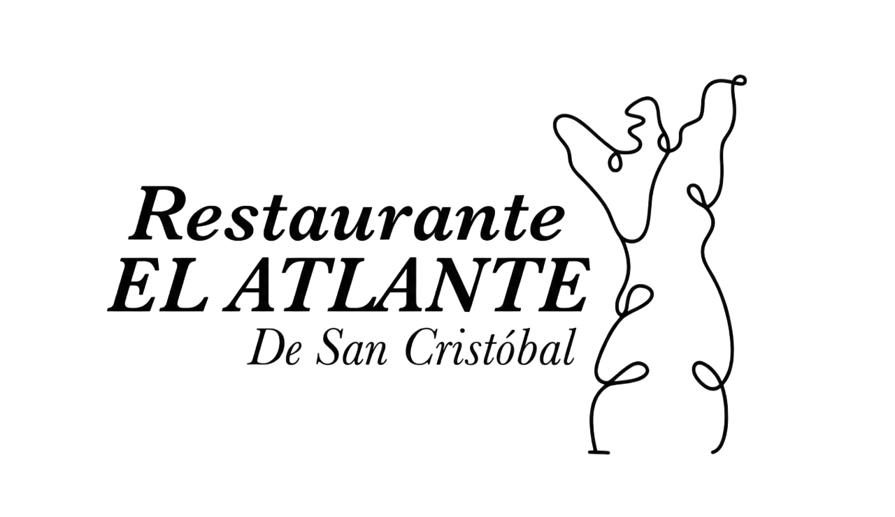
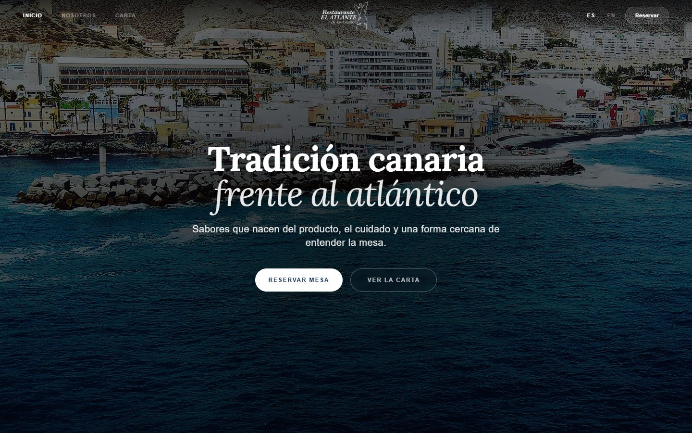

<div align="center">
  

  # El Atlante de San Cristóbal

  Web y sistema de reservas del restaurante El Atlante (Las Palmas de Gran Canaria).

  **En producción:** https://www.elatlantedesancristobal.com

  
</div>

## Qué incluye

### Para clientes
- **Reserva online** con calendario, número de comensales y preferencia de zona.
- **Confirmación y cancelación por enlace** enviado por email (`functions/confirm.ts`, `functions/cancel.ts`).
- Carta, información del restaurante y páginas legales (privacidad, cookies, aviso legal).
- **Español e inglés** (i18next), SEO por página y PWA instalable.

### Para el restaurante
- **Panel de administración:** reservas por estado en un tablero kanban, estadísticas (Recharts), ajustes de calendario y de cada día, y reservas manuales.
- **Panel de camarero** para tablet, con acceso por PIN y modo reposo.
- **Avisos al dueño** de cada reserva nueva e **informe diario** automático por email (Brevo) mediante un webhook programado.

## Stack

| Parte | Tecnología |
|---|---|
| Frontend | React 19, TypeScript, Vite 6, Tailwind CSS, Framer Motion |
| Datos y autenticación | Supabase (Postgres + Auth) |
| Servidor | Cloudflare Pages Functions (emails, confirmaciones e i18n en servidor) |
| Otros | i18next, Recharts, vite-plugin-pwa |

## Desarrollo

```bash
npm install
# .env con VITE_SUPABASE_URL y VITE_SUPABASE_ANON_KEY
npm run dev
```

Las claves del servidor (Brevo, etc.) se configuran como secretos en Cloudflare Pages y no están en el repositorio.
